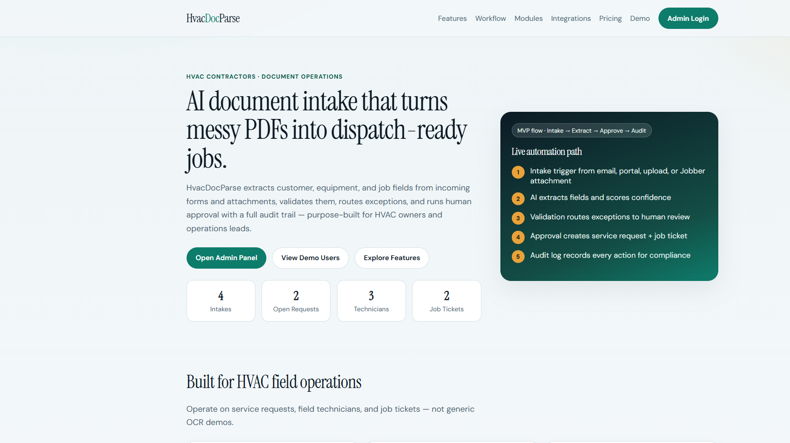
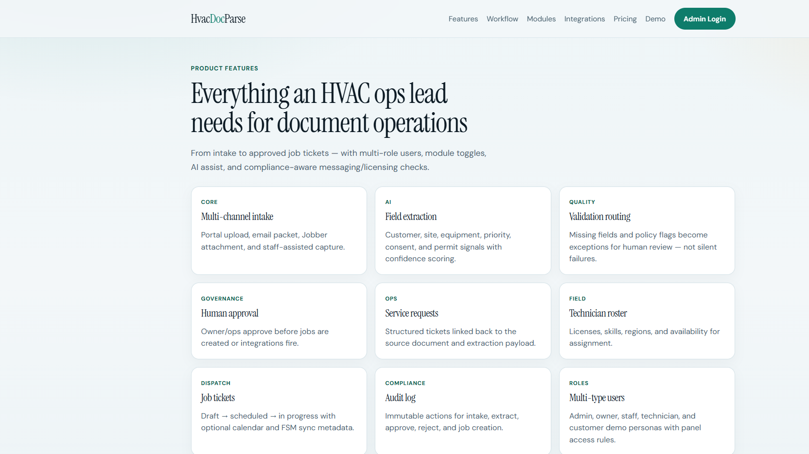
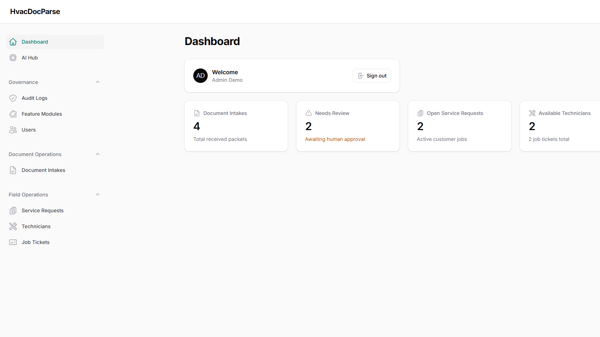
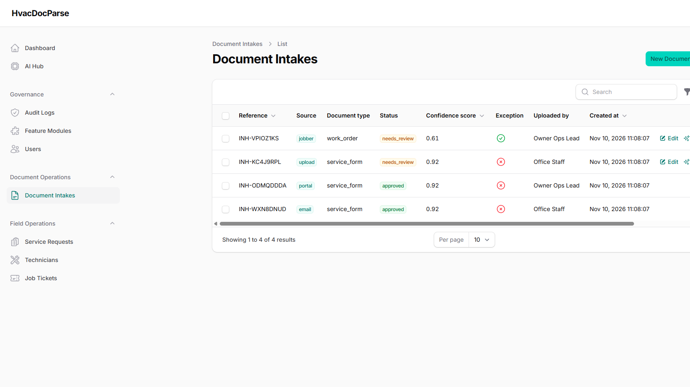

# HvacDocParse — AI Document Intake Extractor for HVAC Contractors (Laravel Filament SaaS)

**HvacDocParse** is a complete AI-powered **document intake extractor** for **HVAC contractors** in **home & field services**. It extracts structured fields from incoming forms, PDFs, and attachments; validates data; routes exceptions; runs human approval; creates **service requests** and **job tickets**; and writes an immutable **audit log**.

Built with **PHP Laravel + Filament**, modular feature flags, multi-role users, Docker Compose on port **8108**, and AI assist hooks via `imrandevbd/laravel-ai-hub`.

> Rank #8 · USA Top 1000 AI Business Automation Opportunities 2026 · Opportunity score 99 · Pilot pricing $299–$1,499/mo

## Live local URLs

- Marketing site: [http://localhost:8108](http://localhost:8108)
- Filament admin: [http://localhost:8108/admin](http://localhost:8108/admin)
- Demo users: [http://localhost:8108/demo](http://localhost:8108/demo)

## SEO / keyword cloud

`HVAC contractors` · `document intake extractor` · `AI PDF extraction` · `HVAC document automation` · `service request software` · `field technician dispatch` · `job ticket automation` · `work order OCR` · `warranty form parsing` · `exception routing` · `human approval workflow` · `audit log compliance` · `messaging consent` · `EPA refrigerant licensing` · `Jobber integration` · `ServiceTitan integration` · `QuickBooks HVAC` · `Google Calendar dispatch` · `Laravel Filament SaaS` · `AI business automation` · `home services ops` · `field service document ops` · `HVAC operations lead software` · `modular feature flags` · `multi-tenant ready admin` · `unicode PDF export` · `AI catalog enrichment`

## Business problem

For HVAC contractors: extract fields from incoming forms, PDFs and attachments, validate and route exceptions; operate on service requests, field technicians and job tickets.

**MVP flow:** 1 intake trigger → draft/action → human approval → audit log

**Target buyer:** HVAC Contractors owner / operations lead  
**Risk / compliance:** MED — messaging consent, licensing and safety

## Features & modules

All modules are toggleable in **Admin → Feature Modules** (and `config/modules.php`).

| Module | Default | Purpose |
|--------|---------|---------|
| Document Intake | ON (core) | Receive portal/email/upload/Jobber packets |
| AI Field Extraction | ON (core) | Extract HVAC customer/equipment/job fields |
| Validation & Exception Routing | ON (core) | Flag missing fields / policy issues |
| Human Approval Queue | ON (core) | Ops approve before jobs are created |
| Audit Log | ON (core) | Immutable action trail |
| Service Requests | ON (core) | Customer/service tickets from approved intake |
| Field Technicians | ON (core) | Roster, licenses, skills, availability |
| Job Tickets | ON (core) | Dispatchable tickets from approvals |
| Messaging Consent Guard | ON | Block outbound SMS without consent |
| Licensing & Safety Checks | ON | Flag permit / safety documentation needs |
| Unicode PDF Export | ON | Multilingual PDF summaries (`laravel-unicode-pdf`) |
| Jobber Integration | OFF | Sync approved jobs |
| ServiceTitan Integration | OFF | Sync techs/jobs |
| QuickBooks Integration | OFF | Billing field mapping |
| Google Calendar Integration | OFF | Calendar holds |
| Attendance Hub | OFF | Local attendance module equivalent |
| AI Catalog / Equipment Lookup | OFF | Enrich models (`laravel-ai-catalog`) |
| Customer Document Portal | OFF | Customer upload channel |

### Packagist packages

Installed when compatible with Laravel 13:

- `imrandevbd/laravel-ai-hub`
- `imrandevbd/laravel-ai-catalog`
- `imrandevbd/laravel-unicode-pdf`
- `imrandevbd/laravel-universal-slug`

Laravel 11/12-only packages (`drutogoti`, `laravel-admin-panel`, `laravel-attendance-hub`) are replaced with equivalent local modules (Filament admin, attendance module flag, workflow services).

## Multi-type users (demo)

| Role | Email | Password |
|------|-------|----------|
| Admin | `admin@hvacdocparse.test` | `password` |
| Owner / Ops Lead | `owner@hvacdocparse.test` | `password` |
| Staff | `staff@hvacdocparse.test` | `password` |
| Technician | `tech@hvacdocparse.test` | `password` |
| Customer | `customer@hvacdocparse.test` | `password` |

Customer role cannot access Filament; admin/owner/staff/technician can.

## Docker run

```bash
docker compose up -d --build
```

App: **http://localhost:8108**  
MySQL host port: `33088` · Redis host port: `6388`

Stop:

```bash
docker compose down
```

## Local (without Docker)

```bash
composer install
cp .env.example .env
# set DB_CONNECTION=sqlite or MySQL
php artisan key:generate
php artisan migrate --seed
php artisan serve --port=8108
```

## Tech stack

- PHP 8.4 · Laravel 13 · Filament 4 · Livewire
- MySQL 8.4 · Redis 7 (Compose)
- Modular config + `module_settings` table
- AI extraction service with deterministic HVAC demo engine + AI Hub ready
- Docker Compose multi-service

## Screenshots









## Public pages

- `/` Home
- `/features` Features
- `/workflow` MVP workflow
- `/modules` Module ON/OFF catalog
- `/integrations` Jobber / ServiceTitan / QuickBooks / Calendar
- `/pricing` Pilot pricing
- `/demo` Demo credentials
- `/admin` Filament panel

## Repository

SEO repo name: `hvac-doc-parse-ai-document-intake-extractor-hvac-contractors-laravel-filament`

## Contact / Hire

- Developer: Imran Ahmed (IMRAN Dev BD)
- Website: https://imrandev.bd/contact
- Email: me@imrandev.bd
- GitHub: https://github.com/imranbru99
